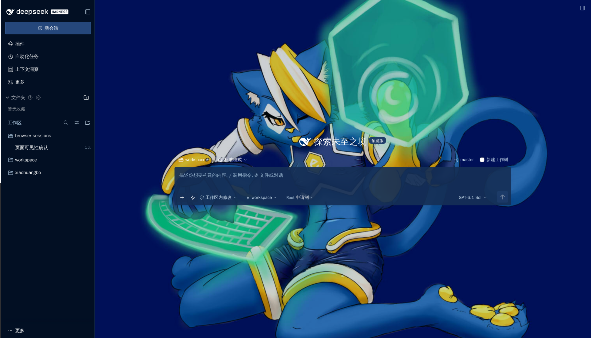
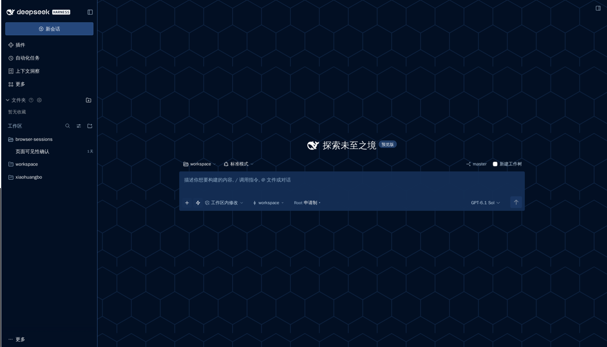

<div align="center">


# DSH e621 Style · e621 蓝色主题

**The classic e621 navy hexagon theme for DeepSeek Harness — custom backgrounds, a random image library, timed rotation, colorful code highlighting and an in-page settings panel.**

**给 DeepSeek Harness 换上 e621 经典深蓝六边形主题：自定义背景、随机图库、定时轮换、彩色代码高亮，以及独立的设置页面。**

[](https://www.npmjs.com/package/@xiaohuangbo/dsh-e621-style)
[](LICENSE)
[](https://github.com/xiaohuangbo/dsh-e621-style)

**Author / 作者**: [xiaohuangbo](https://github.com/xiaohuangbo)<br/>
**Repository / 仓库**: <https://github.com/xiaohuangbo/dsh-e621-style>

</div>

---

## 效果预览 / Preview

点击图片可查看完整尺寸。Click an image for the full size.

| 设置 → e621 蓝色主题 / Settings → e621 blue theme | 会话界面 / Session view |
| --- | --- |
|  |  |

---

## English

A single-package skin that adapts the default hexagon theme of the local [e621ng](https://github.com/e621ng/e621ng) frontend to the DeepSeek Harness Web GUI. It keeps DSH's conversation, sidebar, editor and tool interactions, and restyles them with the classic e621 look: layered navy panels (`#020f23` / `#152f56` / `#1f3c67`), pale blue links (`#b4c7d9`), gold accents (`#e8c446`), the Verdana font stack, 4 px radii and light text inputs with a pale yellow focus fill.

### Features

1. **Classic hexagon background** — an original, self-drawn hexagonal texture in the theme colors. No e621 artwork, logos or mascots are bundled.
2. **Custom background image** — paste an HTTP(S) image URL or pick a local PNG/JPEG/WebP/GIF/AVIF file (up to 6 MiB).
3. **Random background library** — add image URLs line by line or import local images in bulk (up to 100 images, about 24 MiB of data). Random picks avoid immediate repeats where possible.
4. **Timed rotation** — rotate the background every 15–86400 seconds; rotation pauses while the page is hidden. Randomize on every page load, or restore the last successfully shown image.
5. **Readability controls** — panel opacity 35–100%, background dimming 0–85%, blur 0–20 px, image scale 25–300%, sizing (`cover` / `contain` / `auto`) and position.
6. **Code highlighting** — purple-pink keywords, mint strings, gold functions and inline code, light-blue constants, orange parameters and pale blue comments on the e621 DText-style blue code surface with a gold left rule. All syntax colors, comments included, pass a 4.5:1 contrast check on the default opaque code background.
7. **Settings page** — `自动` / `中文` / `English` language buttons (auto follows the DSH language; forced languages affect only this page), e621-style square toggle switches, gold pressed states and a live background preview.
8. **Local storage** — visual preferences and imported images live in this browser's IndexedDB for this site; the plugin never reads conversations, never writes profile files and never scrapes e621. Remote images are loaded by the browser directly.

### Installation

Install from npm into the current DSH profile:

```sh
env 'npm_config_@xiaohuangbo:registry=https://registry.npmjs.org' dsh plugin add @xiaohuangbo/dsh-e621-style@1.2.0
```

The explicit environment override matters when `~/.npmrc` maps the `@xiaohuangbo` scope to GitHub Packages. To install the latest `main` code from GitHub instead, paste the repository URL into the same add box:

```sh
dsh plugin add 'github:xiaohuangbo/dsh-e621-style#main'
```

On the official desktop app, open **Plugins → Add plugin** and enter the npm package name `@xiaohuangbo/dsh-e621-style`. For local development, install the project directory from the DSH Plugin Manager with `install_bundle`, using the package directory as the target.

After enabling, **restart DSH once (or refresh the page)**, then open **Settings → e621 blue theme**. No build step or install scripts are required; the package has zero runtime dependencies.

### Keep one skin enabled

This is a whole-interface skin. If another full skin (such as a Claude-style skin) is enabled at the same time, both rewrite the same global appearance and the page can look wrong. Keep exactly one of them enabled; the others can stay installed.

### Update

```sh
dsh plugin --profile web update @xiaohuangbo/dsh-e621-style
```

Under the default DSH pnpm settings, npm releases younger than 24 hours are not picked up automatically; install the fresh version explicitly with `@xiaohuangbo/dsh-e621-style@^<version>`.

### Troubleshooting

- **Page still shows the old skin** — refresh the browser; if nothing changes, make sure the plugin is enabled and other whole-interface skins are disabled.
- **Settings page is missing** — check that the bundle is enabled in the Plugin Manager, then reopen Settings.
- **A background fails to load** — the previous usable background is kept and an error is shown. Check the URL, hotlink protection, mixed HTTP content or the network; local images and data URLs do not depend on the network.
- **Storage errors** — clearing site data removes the library and preferences; a browser that blocks IndexedDB still shows defaults, and saving reports an error.

### Compatibility

Tested with DSH `0.2.2-rc.1` web profiles. The theme registers a dark in-process theme and token overrides through `ctx.theme`, mounts an unloadable style layer in `shell.overlay`, and contributes its page through `settings.section`; unloading the plugin removes its tokens, styles, image events and timers without touching the DSH root. Browsers need CSS `:has()` support. Colors hardcoded by third-party plugins may not follow DSH theme tokens.

### Development and tests

```sh
npm run build
npm run check   # syntax checks plus 20 tests
npm pack --dry-run
```

Tests cover URL validation and library limits, normalization and numeric boundaries (including language and scale), random selection, CSS escaping, syntax/control/state contrast, and the scoping of theme styles. The browser artifact is assembled from `core.js`, `theme.js`, `styles.js`, `storage.js` and `client.source.js` by `scripts/build.mjs` with no bundler.

### Publishing

```sh
npm run publish:npm    # npmjs.org
npm run publish:gh     # GitHub Packages (npm.pkg.github.com)
npm run publish:both   # publish to both registries in sequence
```

First authenticate to npmjs with `npm login`. For two-factor authentication pass the current code with `npm run publish:npm -- --otp=123456`. For GitHub Packages, create a classic token with `write:packages`, configure `~/.npmrc` (`@xiaohuangbo:registry=https://npm.pkg.github.com` and the `_authToken`), export `GITHUB_TOKEN`, then run `npm run publish:gh`. GitHub Packages visibility is not guaranteed by `--access public`: after the first publish, open the package settings and choose **Public**.

### License

MIT for the plugin's own code and original artwork (the hexagon texture and icon are self-drawn). The palette and layout values are adapted from the local e621ng source (Danbooru Project, BSD 2-Clause); see [THIRD_PARTY_NOTICES.md](THIRD_PARTY_NOTICES.md). This project is not affiliated with e621 or the Danbooru Project, and bundles no e621 artwork.

---

## 简体中文

单包皮肤，把本地 [e621ng](https://github.com/e621ng/e621ng) 前端的默认 hexagon 主题适配到 DeepSeek Harness Web GUI。保留 DSH 的会话、侧栏、编辑器与工具交互，套上经典 e621 外观：三层深蓝面板（`#020f23` / `#152f56` / `#1f3c67`）、淡蓝链接（`#b4c7d9`）、金色强调（`#e8c446`）、Verdana 字体栈、4px 小圆角，以及聚焦变淡黄的亮色输入框。

### 功能

1. **经典六边形背景**：按主题色重新绘制的原创六边形纹理，不附带 e621 的任何美术、徽标或吉祥物。
2. **自定义背景图片**：粘贴 HTTP(S) 图片网址，或选择本地 PNG/JPEG/WebP/GIF/AVIF 文件（单张最多 6 MiB）。
3. **随机背景图库**：逐行添加图片网址或批量导入本地图片（最多 100 张、总数据约 24 MiB），随机选择时尽量避免与上一张重复。
4. **定时轮换**：每 15～86400 秒切换背景，页面隐藏时暂停；可每次打开页面随机，或恢复上次成功显示的随机图片。
5. **可读性调节**：面板不透明度 35%～100%、背景暗色遮罩 0%～85%、模糊 0～20px、图片缩放 25%～300%、缩放模式（铺满 / 完整显示 / 原始大小）与位置。
6. **代码高亮**：关键字粉紫、字符串薄荷绿、函数与行内代码金黄、常量浅蓝、参数橙色、注释浅蓝，配 e621 DText 式蓝色代码底和金色左边线；所有语法颜色（含注释）在默认不透明代码背景上通过 4.5:1 对比度检查。
7. **设置页面**：`自动` / `中文` / `English` 语言按钮（自动跟随 DSH 语言，强制语言只影响本页）、e621 方形开关、金色选中态与实时背景预览。
8. **本地存储**：视觉偏好与导入图片保存在当前浏览器、当前站点的 IndexedDB；插件不读取会话、不写 profile 文件、不抓取 e621 图片，外部图片由浏览器直接加载。

### 安装

从 npm 安装到当前 DSH profile：

```sh
env 'npm_config_@xiaohuangbo:registry=https://registry.npmjs.org' dsh plugin add @xiaohuangbo/dsh-e621-style@1.2.0
```

若 `~/.npmrc` 把 `@xiaohuangbo` scope 指向 GitHub Packages，上面的显式环境变量覆盖必不可少。想用 `main` 分支最新代码，在同一个添加框里填入 GitHub 地址：

```sh
dsh plugin add 'github:xiaohuangbo/dsh-e621-style#main'
```

官方桌面版在「插件 → 添加插件」中填入 npm 包名 `@xiaohuangbo/dsh-e621-style`。本地开发时，可在 DSH Plugin Manager 中用 `install_bundle` 安装项目目录，并把项目目录作为 target。

启用后**重启一次 DSH（或刷新页面）**，然后打开「设置 → e621 蓝色主题」。无需构建或安装脚本，包没有任何运行时依赖。

### 一次只开一套皮肤

这是整页皮肤。若同时启用另一套整体皮肤（例如 Claude 风格皮肤），双方会改写相同的全局外观，界面可能错乱。同一时间只启用一套；其他皮肤可以保留安装状态。

### 更新

```sh
dsh plugin --profile web update @xiaohuangbo/dsh-e621-style
```

DSH 内置 pnpm 默认不自动选择发布未满 24 小时的 npm 版本；想立即用新版，可显式安装 `@xiaohuangbo/dsh-e621-style@^<版本号>`。

### 遇到问题

- **页面还是旧皮肤**：刷新浏览器；仍然没有变化时，确认本插件已启用、其他整体皮肤已停用。
- **找不到设置页**：在插件管理器中确认 bundle 已启用，再重新打开设置。
- **背景加载失败**：会保留上一张可用背景并显示错误。检查网址、防盗链、HTTP 混合内容或网络；本地图片与 data 图片不依赖网络。
- **存储报错**：清除站点数据会删除图库与偏好；浏览器禁用 IndexedDB 时仍显示默认外观，保存操作会报错。

### 兼容范围

已在 DSH `0.2.2-rc.1` Web profile 上验证。主题通过 `ctx.theme` 注册进程内深色主题并叠加令牌层，在 `shell.overlay` 挂载可卸载的样式层，通过 `settings.section` 贡献设置页；卸载插件会清除令牌、样式、图片事件与计时器，不替换 DSH 根组件。浏览器需要支持 CSS `:has()`。第三方插件硬编码的颜色可能不跟随 DSH 主题令牌。

### 开发与测试

```sh
npm run build
npm run check   # 语法检查与 20 项测试
npm pack --dry-run
```

测试覆盖 URL 校验与图库容量、配置归一化与数值边界（含语言与缩放）、随机选择、CSS 转义、语法色/控件/文字对比度，以及主题样式的作用域限定。浏览器产物由 `scripts/build.mjs` 从 `core.js`、`theme.js`、`styles.js`、`storage.js`、`client.source.js` 组装，无需打包器。

### 发布

```sh
npm run publish:npm    # 发布到 npmjs.org
npm run publish:gh     # 发布到 GitHub Packages（npm.pkg.github.com）
npm run publish:both   # 依次发布到两个 registry
```

先用 `npm login` 登录 npmjs；如需双重验证，运行 `npm run publish:npm -- --otp=123456`（换成当前六位验证码）。发布到 GitHub Packages 需要带 `write:packages` 权限的 classic token，配置 `~/.npmrc`（`@xiaohuangbo:registry=https://npm.pkg.github.com` 与 `_authToken`），导出 `GITHUB_TOKEN` 后运行 `npm run publish:gh`。GitHub Packages 的公开状态不由 `--access public` 自动保证：首次发布后请在包设置中选择 **Public**。

### 许可

插件自有代码与原创美术（六边形纹理、图标均为自绘）采用 MIT。配色与布局数值改编自本地 e621ng 源码（Danbooru Project，BSD 2-Clause），详见 [THIRD_PARTY_NOTICES.md](THIRD_PARTY_NOTICES.md)。本项目与 e621、Danbooru Project 无隶属关系，也不附带 e621 美术资源。
